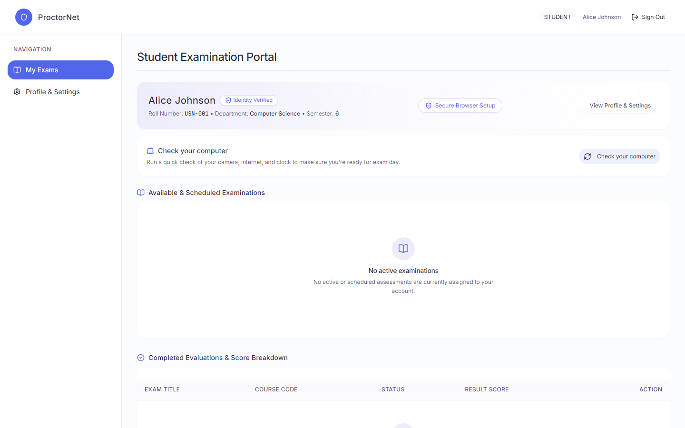
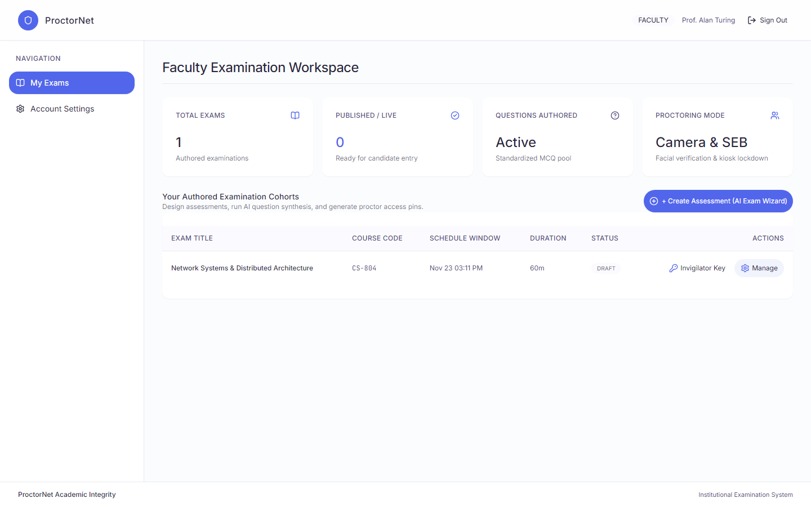
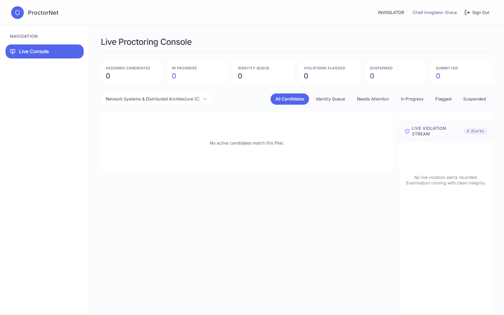
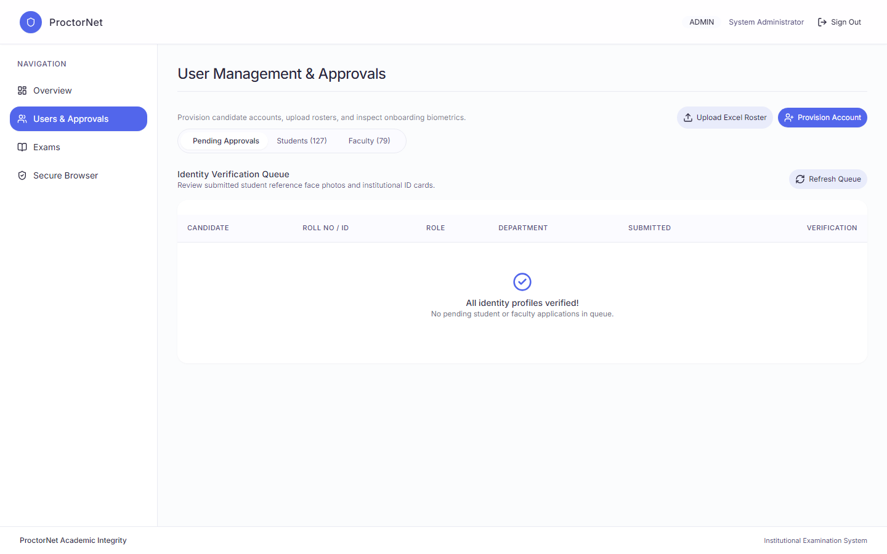
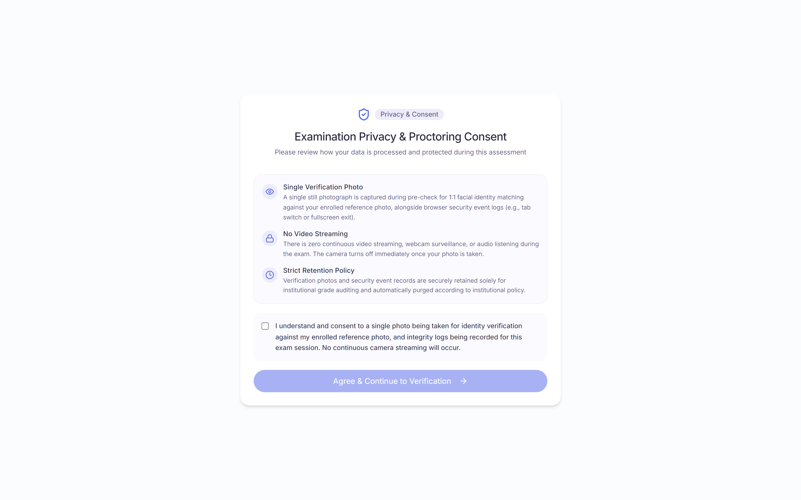
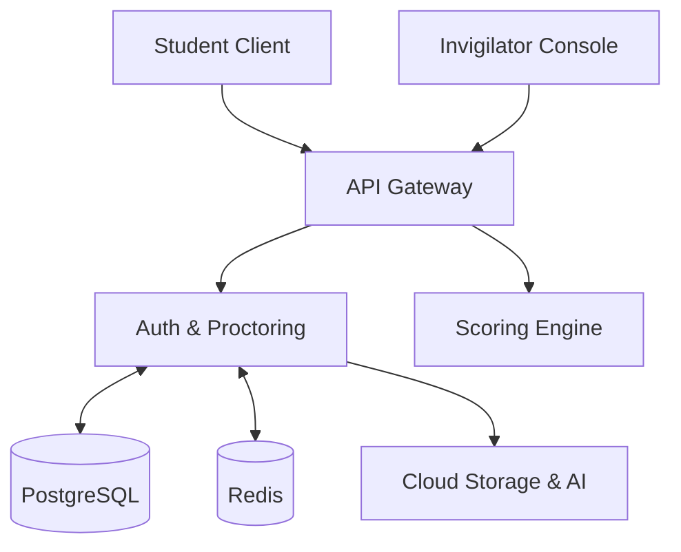

# ProctorNet

Scalable Online Exam Proctoring System

[](https://github.com/SudeepKagi/online-exam-proctoring/actions/workflows/ci.yml)
[](https://proctornet.duckdns.org/)



ProctorNet is a web-based examination and proctoring platform. It is designed for educational institutions and universities. The software helps teachers conduct exams online while discouraging malpractice. It provides real-time invigilation and automated evaluation without requiring specialized hardware.

## Features by Role

### Student
- Perform a hardware check for camera, microphone, and internet latency.
- Verify candidate identity using automated face matching before entering exams.
- Answer questions in an interactive arena with instant auto-save.
- Track remaining duration using an authoritative server countdown timer.
- Submit attempts easily or let the timer auto-submit when time expires.

### Faculty
- Create exams step-by-step with custom schedules and durations.
- Configure positive marks, negative penalties, and partial scoring rules.
- Generate questions from course syllabus documents using AI assistance.
- Enforce secure browser lockdown settings for examination sessions.
- Export grade sheets and student submission records for academic evaluation.

### Invigilator
- Monitor active exam candidates through a live roster console grid.
- View real-time video snapshots and presence status for all students.
- Receive immediate alerts for tab switching, multiple faces, and exits.
- Pause, resume, or terminate student attempts directly during exams.
- Review stored incident logs and photographic evidence after sessions.

### Admin
- Review and approve pending student and faculty registration requests.
- Manage institutional security policies and secure browser configurations.
- Inspect system audit logs and monitor examination platform operational health.
- Export student rosters and audit logs for institutional compliance.

## How an Exam Works

1. **Setup**: Faculty creates an exam with custom rules and schedules.
2. **Pre-Check**: Student passes camera, microphone, and identity verification checks.
3. **Testing**: Student answers questions while the system auto-saves progress.
4. **Monitoring**: The system logs anomalies and alerts the invigilator in real time.
5. **Grading**: The system evaluates answers and calculates final scores automatically.

## Screenshots

### Faculty Exam Management


### Invigilator Live Console


### Admin User Management


### Student Mobile Pre-Check


## Tech Stack

| Layer | Technology |
| :--- | :--- |
| **Frontend** | React 19, Tailwind CSS, Vite |
| **Backend** | Node.js, Express.js |
| **Database** | PostgreSQL with Prisma ORM |
| **Cache & Real-Time** | Redis, Socket.io |
| **Storage & AI** | AWS S3, AWS Rekognition, Google Gemini |
| **Client Lockdown** | Safe Exam Browser (SEB) |

## System Architecture

The client layer interacts with an Express application gateway. The gateway validates requests and coordinates identity verification. Exam states and answers are saved transactionally in PostgreSQL. Real-time invigilation events stream through Socket.io and Redis. Biometric matching and media storage run through cloud services.



## Quick Start

Run these commands to set up the project locally:

```bash
git clone https://github.com/SudeepKagi/online-exam-proctoring.git
cd online-exam-proctoring
cp .env.example .env
npm install
npm run db:migrate
npm run db:seed
npm run dev
```

Open `http://localhost:5173` in your browser to view the application.

## Configuration

All configuration is managed using environment variables. Refer to `.env.example` for the complete list of variables:

- `PORT`, `NODE_ENV`, `APP_URL`, `VITE_API_URL`
- `DATABASE_URL`, `DIRECT_URL`, `REDIS_URL`
- `JWT_SECRET`, `JWT_REFRESH_SECRET`, `CORS_ORIGIN`
- `AWS_REGION`, `AWS_ACCESS_KEY_ID`, `AWS_SECRET_ACCESS_KEY`, `S3_BUCKET`
- `REQUIRE_IDENTITY_VERIFICATION`, `FACE_MATCH_THRESHOLD`, `FACE_DRIVER`
- `GEMINI_API_KEY`, `GEMINI_MODEL`, `OPENAI_API_KEY`, `OPENAI_MODEL`
- `SEB_CONFIG_KEY`, `SEB_ENFORCE_MODE`

## Running Tests

Run the backend test suite:

```bash
npm test
```

Run the end-to-end browser test suite:

```bash
npm run test:e2e
```

Run docs validation check:

```bash
npm run docs:check
```

## Deployment

ProctorNet runs on an Ubuntu server managed by Systemd and Caddy. Remote deployments run through automated command pipelines with rollback safeguards. Read the [Deployment Guide](docs/DEPLOYMENT.md) for complete details.

## Security and Privacy

- Authenticates users with dual JSON Web Tokens (JWT) in secure cookies.
- Strips answer keys from student payloads to prevent client-side inspection.
- Enforces server-authoritative timers that students cannot alter.
- Collects pre-exam reference photos and violation screenshots for faculty review.
- Read the [Security and Privacy Guide](docs/SECURITY_AND_PRIVACY.md) for data policies.

## Status and Limitations

- Web-based proctoring works across all modern desktop browsers.
- Secure browser lockdown is currently configured for Windows environments.
- Read the full [Secure Browser Guide](docs/SECURE_BROWSER.md) for verification status.

## Documentation Index

- [Getting Started](docs/GETTING_STARTED.md): Local development setup guide.
- [Architecture](docs/ARCHITECTURE.md): System components and data flow overview.
- [User Guide](docs/USER_GUIDE.md): Step-by-step guide for each role.
- [Secure Browser](docs/SECURE_BROWSER.md): Lockdown browser setup and status.
- [Deployment](docs/DEPLOYMENT.md): Production hosting guide.
- [Testing](docs/TESTING.md): Unit and end-to-end testing instructions.
- [Security and Privacy](docs/SECURITY_AND_PRIVACY.md): Data retention and protection details.
- [Docs Index & Glossary](docs/README.md): Documentation roadmap and terminology.

## Author & License

Created by Sudeep S Kagi. Released under the MIT License.
