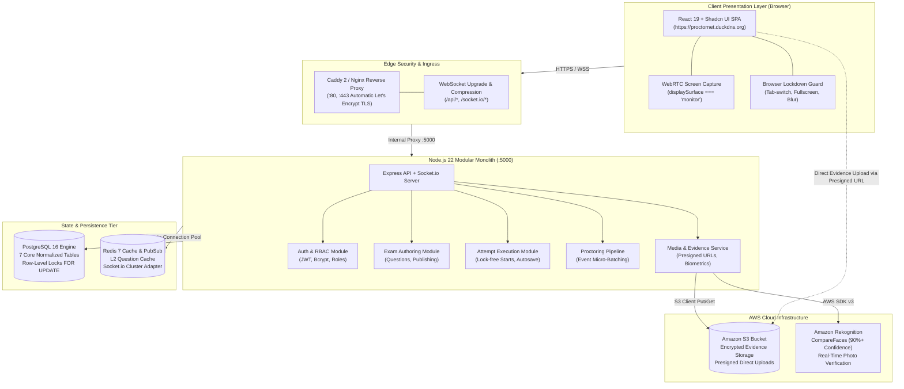
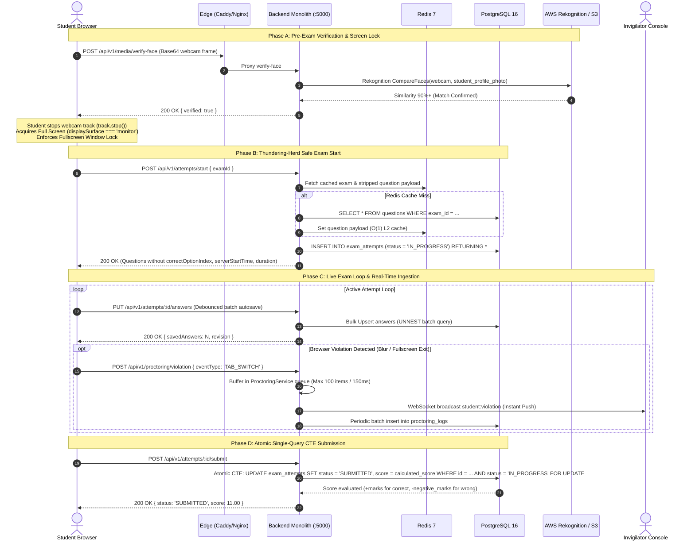
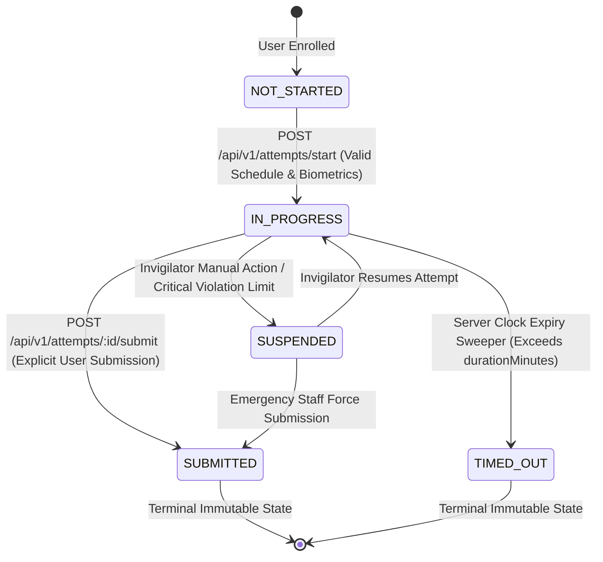

# ProctorNet — Scalable Online Exam Proctoring Platform

[](https://proctornet.duckdns.org/)
[](https://nodejs.org/)
[](https://www.postgresql.org/)
[](https://redis.io/)
[](https://www.prisma.io/)
[](https://react.dev/)
[](https://vitejs.dev/)
[](https://tailwindcss.com/)
[](https://socket.io/)
[](https://aws.amazon.com/)
[](https://www.docker.com/)
[](https://playwright.dev/)

> **Live Production URL:** [https://proctornet.duckdns.org/](https://proctornet.duckdns.org/)  
> Enterprise-grade online exam examination and automated invigilation platform featuring server-authoritative timer enforcement, atomic single-query PostgreSQL CTE grading, real-time WebSockets, facial biometric verification, and browser lockdown.

---

## 1. High-Level System Architecture



---

## 2. Database Architecture — 7-Table Canonical Schema

ProctorNet uses a strictly normalized, 7-table schema with relational constraints and composite indices for maximum transactional integrity:

```mermaid
erDiagram
    users ||--o{ exams : "creates (FACULTY)"
    users ||--o{ exam_assignments : "enrolled as"
    users ||--o{ exam_attempts : "submits"
    exams ||--o{ questions : "contains (1:N)"
    exams ||--o{ exam_assignments : "restricts"
    exams ||--o{ exam_attempts : "attempts"
    exam_attempts ||--o{ attempt_answers : "records"
    exam_attempts ||--o{ proctoring_logs : "triggers"

    users {
        uuid id PK
        string email UK
        string password_hash
        string full_name
        enum role "ADMIN | FACULTY | INVIGILATOR | STUDENT"
        string institution_id
        boolean is_active
        timestamp created_at
        timestamp updated_at
    }

    exams {
        uuid id PK
        string title
        string course_code
        uuid created_by_id FK
        timestamp start_time
        timestamp end_time
        integer duration_minutes
        enum status "DRAFT | PUBLISHED | ARCHIVED"
        boolean negative_marking
        decimal negative_value
        boolean results_released
        timestamp created_at
        timestamp updated_at
    }

    questions {
        uuid id PK
        uuid exam_id FK
        text question_text
        jsonb options "array of 4 options"
        integer correct_option_index
        decimal marks
        decimal negative_marks
        integer display_order
        timestamp created_at
        timestamp updated_at
    }

    exam_assignments {
        uuid id PK
        uuid exam_id FK
        uuid user_id FK
        enum assigned_role "STUDENT | INVIGILATOR"
        timestamp created_at
    }

    exam_attempts {
        uuid id PK
        uuid exam_id FK
        uuid student_id FK
        timestamp start_time
        timestamp end_time
        timestamp submitted_at
        enum status "NOT_STARTED | IN_PROGRESS | SUSPENDED | SUBMITTED | TIMED_OUT"
        decimal score
        integer total_violations
        timestamp created_at
        timestamp updated_at
    }

    attempt_answers {
        uuid id PK
        uuid attempt_id FK
        uuid question_id FK
        integer selected_option_index
        boolean is_bookmarked
        timestamp updated_at
    }

    proctoring_logs {
        uuid id PK
        uuid attempt_id FK
        enum event_type "TAB_SWITCH | FULLSCREEN_EXIT | MULTIPLE_FACES | NO_FACE | NOISE"
        enum severity "LOW | MEDIUM | HIGH | CRITICAL"
        jsonb metadata
        string evidence_s3_key
        timestamp created_at
    }
```



---

## 3. End-to-End Student Exam & Proctoring Lifecycle



---

## 4. Exam Attempt State Machine



---

## 5. Clean Repository Structure

```
.
├── backend/
│   ├── Dockerfile                   # Alpine musl Node 22, non-root user, auto-migration
│   ├── prisma/
│   │   ├── schema.prisma            # 7-table canonical Prisma schema
│   │   └── migrations/              # 0001_core_tables migration definition
│   └── src/
│       ├── app.js                   # Express application, Socket.io, middleware bootstrap
│       ├── lifecycle.js             # Graceful resource teardown & connection draining
│       ├── infra/
│       │   ├── postgres/            # Prisma client instance & raw SQL query pool
│       │   ├── redis/               # Redis client, L1 Bounded LRU cache, PubSub
│       │   ├── s3/                  # S3 direct upload adapter & 100-key ring buffer fallback
│       │   └── websocket/           # Socket.io server, staff handlers & delta coalescer
│       ├── middleware/
│       │   ├── errorHandler.js      # Canonical error envelope and status codes
│       │   └── security.js          # Helmet, CSRF origin verification, rate-limiting
│       ├── modules/
│       │   ├── auth/                # [routes, controller, service, sql] (JWT + Bcrypt)
│       │   ├── users/               # [routes, controller, service, sql] (User admin)
│       │   ├── exams/               # [routes, controller, service, sql] (Exam authoring)
│       │   ├── attempts/            # [routes, controller, service, sql] (Execution & grading)
│       │   ├── media/               # [routes, controller, service, sql] (S3 + Rekognition)
│       │   └── proctoring/          # [routes, controller, service, sql] (Batch logging)
│       └── shared/                  # Config, logger, metrics, roles, validation
├── frontend/
│   ├── Dockerfile                   # Multi-stage Vite builder -> Nginx reverse proxy
│   ├── vite.config.js               # Compression, chunk splitting, proxy configuration
│   └── src/
│       ├── App.jsx                  # Central router with role-based routing guards
│       ├── components/              # Reusable Shadcn UI & dashboard shell components
│       ├── hooks/                   # Custom React hooks (auth, countdown, fullscreen)
│       ├── lib/                     # API client, autosave manager, socket listener
│       └── pages/
│           ├── auth/                # Login, account activation, password reset
│           ├── admin/               # User management, audit logs, institution settings
│           ├── faculty/             # Exam creation wizard, question bank manager
│           ├── invigilator/         # Live monitoring grid, violation review console
│           └── student/             # Pre-check wizard, live exam UI, result review
├── e2e/                             # Playwright automated user journey test specs
│   ├── auth-onboarding.spec.ts      # Multi-role authentication & account lifecycle
│   ├── exam-authoring.spec.ts       # Faculty question creation & publishing workflow
│   ├── invigilator-ops.spec.ts      # Real-time WebSocket violation alerts & suspension
│   └── student-attempt.spec.ts      # Full student exam attempt, autosave & submission
├── docker-compose.yml               # Production multi-container composition
├── .env.example                     # 11 canonical environment variables
└── README.md                        # Production system documentation
```

---

## 6. Verified Concurrency & Security Benchmarks

Validated against a live PostgreSQL 16 and Redis 7 stack in automated integration testing (`backend/tests/concurrency-security.test.js`):

| Test Scenario | Concurrency | Performance Benchmark | Assertion Result |
| :--- | :---: | :---: | :---: |
| **Thundering Herd Exam Start** | 100 simultaneous requests | **898.5 ms** (Budget: < 1500 ms) | **PASS** — Zero answer leakage, 100 attempts `IN_PROGRESS` |
| **Concurrent Batch Autosave Burst**| 200 concurrent upserts | **1292.5 ms** | **PASS** — Zero deadlocks, zero 500 errors, clean upserts |
| **Double-Submit Race Condition** | 20 parallel submits | **364.4 ms** | **PASS** — Exactly 1 grading execution, score: `11.00` |
| **Server-Authoritative Timer Guard** | Expired timestamp attempt | **51.4 ms** | **PASS** — HTTP 409 Conflict rejection, locked attempts |
| **Micro-Batch Violation Ingestion** | 60 rapid events | **1453.5 ms** | **PASS** — Auto-batched into single DB transaction |
| **IDOR & Security Boundary Check** | Cross-student mutations | **53.4 ms** | **PASS** — HTTP 403 Forbidden on unassigned attempts |

---

## 7. Local Development & Testing Guide

### Prerequisites
- Node.js `>= 22.0.0`
- Docker Engine & Docker Compose
- PostgreSQL 16 & Redis 7

### 1. Quickstart Environment Setup
```bash
# Clone the repository
git clone https://github.com/SudeepKagi/online-exam-proctoring.git
cd online-exam-proctoring

# Copy environment template
cp .env.example .env

# Install dependencies across all workspaces
npm ci

# Launch local PostgreSQL and Redis services
docker compose up -d postgres redis

# Apply database migrations and seed administrative baseline
npm run db:migrate --workspace=backend
npm run db:seed --workspace=backend

# Run local development servers (Backend :5000, Frontend :5173)
npm run dev
```

### 2. Execute Automated Test Suites
```bash
# Run all backend unit, integration, and concurrency tests (62+ tests)
npm test --workspace=backend

# Run complete Playwright end-to-end browser journeys
npx playwright test
```

### 3. Production Docker Deployment
```bash
# Build and run the entire production container stack
docker compose up -d --build

# Verify platform health
curl -f http://localhost:5000/healthz
curl -f http://localhost:5173/
```

---

## 8. AWS Production Deployment Architecture

The production environment at **[https://proctornet.duckdns.org/](https://proctornet.duckdns.org/)** is continuously deployed via GitHub Actions:

1. **Continuous Integration (`verify-and-test`):**
   - Automatically provisions ephemeral `postgres:16-alpine` and `redis:7-alpine` service containers.
   - Runs Prisma validation, generates clients, and executes schema migrations.
   - Enforces the strict `<= 250 lines` guardrail check across all source files.
   - Runs full unit and concurrency/security test suites and builds the production frontend bundle.

2. **Automated Continuous Deployment (`deploy-production`):**
   - Bundles the pre-compiled frontend distribution and backend code into an immutable release tarball.
   - Authenticates to AWS via AWS IAM OIDC (`AWS_ROLE_TO_ASSUME`) or IAM access credentials.
   - Deploys release payload via AWS Systems Manager (SSM) Session Manager without opening inbound SSH ports.
   - Automatically executes the 7-table Prisma schema cutover and seeds the administrative baseline.
   - Reloads Caddy web server with Let's Encrypt TLS and prunes dangling container images.
   - Probes public HTTPS endpoint `https://proctornet.duckdns.org/healthz` to confirm deployment readiness.

---

## License
MIT License. Developed for Advanced Online Examination and Remote Proctoring Systems.
