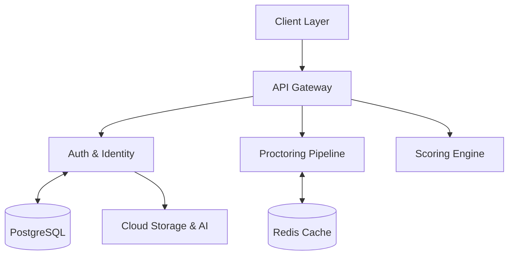

# System Architecture

ProctorNet uses a modular web architecture. It separates presentation, application logic, persistence, and real-time messaging.

## Architectural Overview

The application consists of four primary tiers:

1. **Client Layer**: Single-page application built with React and Tailwind CSS. It runs in standard browsers and Safe Exam Browser environments.
2. **Application Gateway**: Node.js and Express REST API. It handles authentication, validates payloads with Zod schemas, and coordinates proctoring sessions.
3. **Persistence and Cache**: PostgreSQL database managed through Prisma ORM. Redis coordinates real-time message broadcasting and session storage.
4. **Cloud and AI Services**: AWS S3 stores student reference photos and violation snapshots. AWS Rekognition performs facial verification, while Google Gemini assists question creation.

## Data Models

The PostgreSQL database stores 11 primary data models:

- **User**: User profiles, institutional IDs, hashed passwords, and reference photo keys.
- **Exam**: Exam metadata, scheduled start and end times, durations, and security configurations.
- **Question**: Multiple-choice questions, options, positive marks, and negative penalties.
- **ExamAssignment**: Links assigning specific students and faculty to individual exams.
- **ExamAttempt**: Candidate test sessions, start and submit timestamps, scores, and face verification statuses.
- **AttemptAnswer**: Saved candidate responses per question with bookmark flags.
- **ProctoringLog**: Audit records of malpractice events, severity ratings, and photo evidence keys.
- **SystemSetting**: Key-value pairs storing institutional configurations and browser policy settings.
- **StudentReadinessReport**: Pre-exam diagnostic telemetry including camera, microphone, and latency status.
- **StudentConsent**: Records of candidate agreement to institutional proctoring terms.
- **ExamDraft**: Saved working drafts for faculty creating exams in the wizard.

## Real-Time Telemetry Pipeline

The invigilator console receives live updates during active exams. Candidate events flow from the browser to the backend via WebSockets. To preserve database performance during exam surges, events are buffered in memory and written in small batches. The server then pushes incident alerts to invigilator dashboards using Redis pub/sub messaging.
