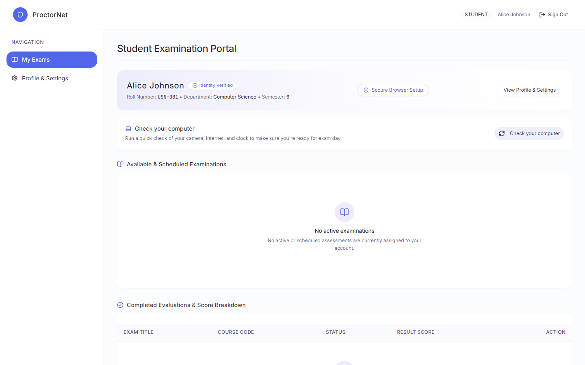
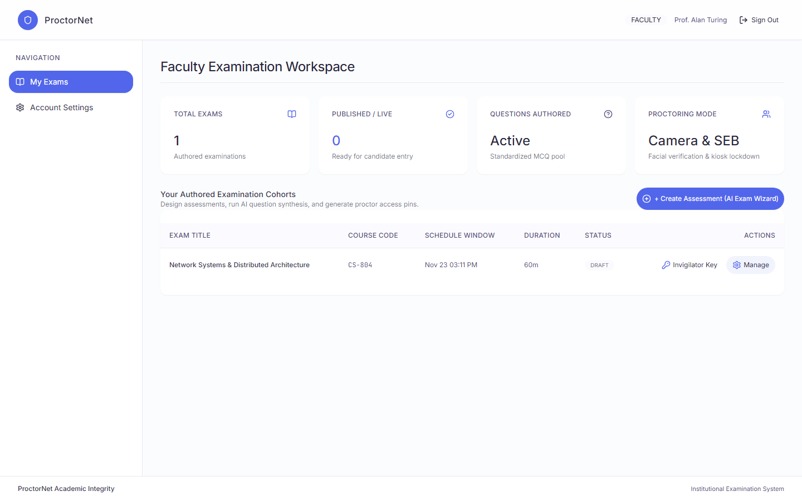
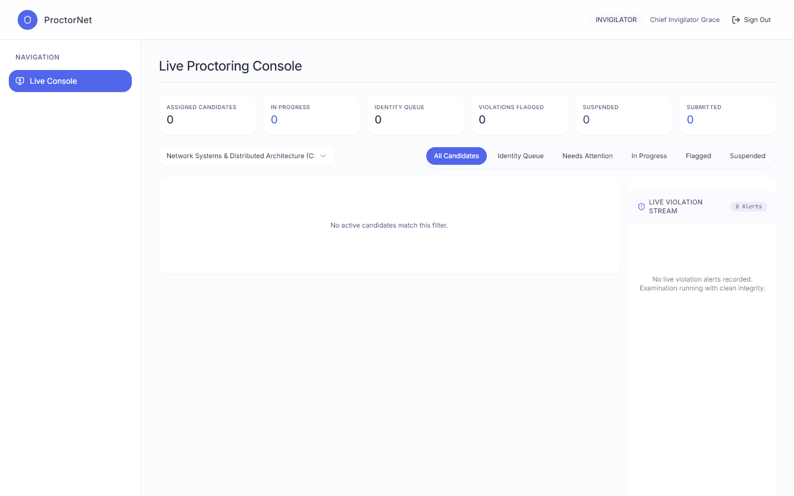
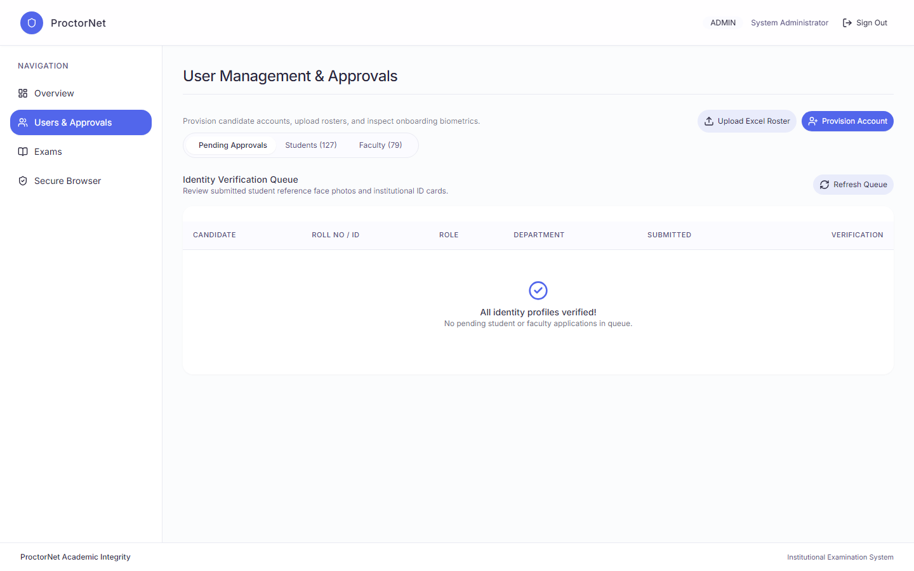

# User Guide

This guide describes features and workflows for each role in ProctorNet.

## Student Workflow

Students access scheduled exams through their personal dashboard. Before entering an exam, each student completes a diagnostic pre-check.

### Key Actions
1. **Complete Pre-Check**: Test your camera, microphone, and internet latency.
2. **Verify Identity**: Capture a live webcam photo to match against your stored institutional record.
3. **Take Examination**: Read questions, select options, and mark questions for review in the palette.
4. **Auto-Save Responses**: Answers persist automatically. If your connection drops, responses queue locally until restored.
5. **Submit Attempt**: Click submit when finished, or let the server auto-submit when the countdown expires.

---

## Faculty Workflow

Faculty members author exams, manage question banks, configure marking rules, and publish assessments.

### Key Actions
1. **Create an Exam**: Open the exam wizard to enter titles, course codes, dates, and durations.
2. **Author Questions**: Add multiple-choice questions with custom point values and negative penalties.
3. **Use AI Assistance**: Upload syllabus PDF documents to generate draft questions automatically.
4. **Configure Security**: Enable identity verification gates and secure browser lockdown requirements.
5. **Review Results**: Export student grades and inspect individual answer sheets.

---

## Invigilator Workflow

Invigilators monitor active examinations through a real-time console. The console shows candidate telemetry and camera frames.

### Key Actions
1. **Monitor Live Grid**: View real-time video snapshots and connectivity status for all active candidates.
2. **Track Malpractice Alerts**: Receive instant notifications for tab switches, missing faces, or multiple persons.
3. **Inspect Evidence**: Click incident cards to review stored snapshot images and incident timestamps.
4. **Intervene Directly**: Temporarily pause or terminate attempts for candidates violating exam rules.
5. **Approve Identity Overrides**: Manually approve candidates whose automated facial verification required verification.

---

## Admin Workflow

Institutional administrators manage accounts, approve faculty and student registrations, and configure global settings.

### Key Actions
1. **User Approvals**: Review new user registrations and activate approved accounts.
2. **Role Assignment**: Assign or update user roles between student, faculty, invigilator, and administrator.
3. **Secure Browser Policies**: Upload institutional configuration files and manage browser security keys.
4. **System Audits**: Inspect system-wide audit logs and monitor server health.
