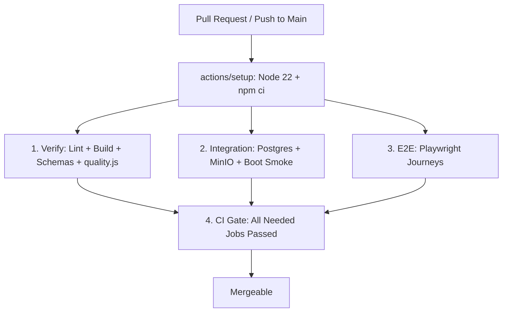

# Runbook: CI/CD Pipeline & Gate Budget Policy

> **Objective:** Maintain PR feedback cycles under 8 minutes, eliminate false positives, and guarantee deterministic error diagnosing.

---

## 1. Gate Budget Policy

Every check executed in the blocking CI pipeline (`ci.yml`) must satisfy four mandatory constraints:

1. **Deterministic Red State:** The check must have an explicit failing example or test proving it turns red upon actual defects.
2. **Execution Budget (< 60s):** Individual verification gates must complete in under 60 seconds (consolidated in `scripts/ci/quality.js`).
3. **Actionable Remediation:** Failures must output the file path, line number, and exact command required to reproduce and fix locally.
4. **Owner & Flake Policy:** Any check failing > 2× per month due to non-bug reasons (e.g., flakiness or documentation drift) is automatically demoted to `.github/workflows/nightly.yml`.

---

## 2. Blocking Pipeline Architecture



### Blocking Jobs (Max 4 Jobs + Gate)
- **`verify`**: Linting (FE/BE), Frontend Build, Prisma Validate & Migration Diff, `scripts/ci/quality.js`.
- **`integration`**: Lite profile parity (Postgres 16 + MinIO), backend integration tests, boot smoke test.
- **`e2e`**: Playwright browser journeys on PRs touching code or carrying `e2e` label.
- **`ci-gate`**: Evaluates all dependent job states; fails if any required job is non-success.

---

## 3. "CI Failed — What Now?" Flowchart

```
                 [CI Pipeline Turns Red]
                           │
                           ▼
          Run diagnostician on local machine:
               npm run ci:doctor -- latest
                           │
        ┌──────────────────┴──────────────────┐
        ▼                                     ▼
 [Signature Matched]                  [No Known Signature]
 - Database connection refused        Run verification locally:
 - Missing module dependency               npm run verify
 - Quality gate violation                      or
 - Playwright locator timeout              npm run ci:local
        │                                     │
        ▼                                     ▼
Execute printed reproduction           Inspect local stack trace,
command and fix source code           fix issue, commit & push
```

---

## 4. Local Reproduction Toolkit

### 4.1 Run Consolidated Quality Suite (< 3s)
```bash
node scripts/ci/quality.js
# Or target a single check:
node scripts/ci/quality.js --only banned-terms
```

### 4.2 Run Full Verification Suite
```bash
npm run verify
```

### 4.3 Clean-Room Local CI Replica
```bash
# Starts Postgres & MinIO containers, applies migrations, runs verify + integration:
npm run ci:local

# Include Playwright journeys:
npm run ci:local -- --e2e
```

### 4.4 Diagnose Failed CI Run
```bash
npm run ci:doctor -- latest
```
